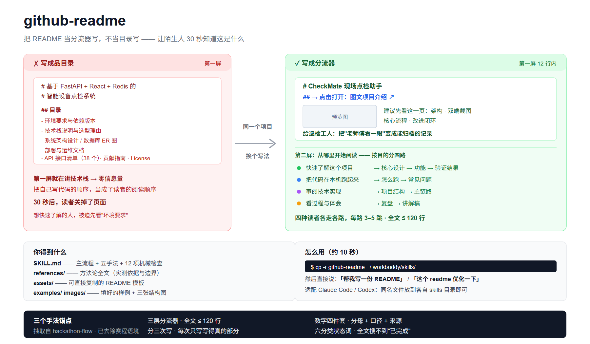

# github-readme

## [→ 打开 SKILL.md：主流程 + 五手法 + 12 项机械检查](SKILL.md)

**一句话：把 README 当分流器写，不当目录写。**

一份 README 的成败在前 12 行：陌生人打开仓库，是点进去继续看还是直接关掉，在这一屏就定了。本 skill 给一套经过实测的写法——不负责"讲清楚"，只负责"把对的读者送到对的那一页"。

方法论抽取自 [hackathon-flow](https://github.com/fqyy360t/hackathon-flow) 的 README 章节，已去除赛程语境（G2 / F 点 / 评分表），保留全部可迁移手法。



---

## 从哪里开始阅读

| 你的目的 | 建议路线 |
|---|---|
| 30 秒知道这 skill 干什么 | 本页 → [SKILL.md](SKILL.md) 的「核心心智」三条 |
| 现在就要写一份 README | [assets/README模板.md](assets/README模板.md) → [SKILL.md](SKILL.md) Step 4 的 12 项检查 |
| 想知道手法为什么有效 | [references/README与门面.md](references/README与门面.md) §一（五个手法） |
| 想看"填好"是什么样 | [examples/demo-README.md](examples/demo-README.md) |
| 改这套方法论本身 | [references/README与门面.md](references/README与门面.md) §八（边界）→ SKILL.md「来源与维护」 |

---

## 这是什么问题

README 写砸的方式高度一致：写成目录、写成架构文档、数字裸奔、边界不写。

| 常见失败 | 本 skill 的处理 |
|---|---|
| 第一屏开始讲技术栈，零信息量 | 第一屏只有三样：名字 / 一句话 / 一个能点的入口 |
| 把自己写代码的顺序当阅读顺序 | 第二屏按目的分四路，每路 3–5 跳 |
| "准确率提升到 98%" | 数字四件套：数字 + 分母 + 口径 + 来源 |
| 通篇二元完成态断言 | 状态只用六分类，只写六档进度、不写绝对完成 |
| 只写成功，不写会崩什么 | 边界段三栏：没做的 / 没验证的 / 会崩的 |

## 里面有什么

| 文件 | 一句话 |
|---|---|
| [SKILL.md](SKILL.md) | 触发条件 + 四步主流程 + 五手法摘要 + 铁律速查 |
| [references/README与门面.md](references/README与门面.md) | 方法论全文：实测时间线、五手法论证、自查 12 项判据、适用边界 |
| [assets/README模板.md](assets/README模板.md) | 可直接复制到仓库根的模板，每段带前置条件提示 |
| [examples/demo-README.md](examples/demo-README.md) | 填好的成品样例（虚构项目 CheckMate 设备点检助手） |
| [images/](images/) | hero 对比图 + 三张结构图：三层分流器 / 分三次写 / 数字与状态 |

## 三个核心设计

### 1. 三层分流器：第一屏只负责"送过去"

第一屏（12 行）→ 分流表（4 行）→ 正文六段（60 行）→ 仓库结构（12 行）→ 结尾，全文 **≤ 120 行**。
"讲清楚"的责任外包给一个图文页，README 永远只有一屏。**我们没有做**更长的 README——超过就是结构文档。

### 2. 分三次写：每次只写当时写得真的部分

能跑之后写第一屏/怎么跑/边界（40min）→ 功能冻结前写验证结果/截图（30min）→ 对外交付前写口径对照/结尾（60min）。
**我们没有做**"最后一起补"——那样写出来的边界段，只会记得成功的部分。

### 3. 可信度两件套：数字四件套 + 六分类状态词

`数字 + 分母 + 这一轮口径 + 来源`；状态只写 `未见实现 / 代码已有 / 局部实测 / 报告待验证 / 完整验收 / 方向待定`。
**我们没有做**给数字打折以外的包装——先给自己的数字打个折，读者反而全信了。

## 怎么用

```bash
# 1. 放到用户级 skill 目录（Windows 下路径换成 %USERPROFILE%\.workbuddy\skills\）
mkdir -p ~/.workbuddy/skills
cp -r github-readme ~/.workbuddy/skills/

# 2. 让它触发：直接说"帮我写一份 README" / "这个仓库的 readme 优化一下"

# 3. 或者手动套模板
cp assets/README模板.md /path/to/your/repo/README.md
```

适配其他 agent 框架：`SKILL.md` 用标准 front-matter（name + description），可同名放到 Claude Code 的 `~/.claude/skills/` 或 Codex 的 skills 目录。

## 效果依据

不是凭观感。原始依据是一份冠军仓库的**提交历史还原**：18 个 commit / 4 个时间簇 / 跨 8 天——核心 README 是交付后写的、素材是开发中攒的、第一波只花 32 分钟（说明排版根本不花时间）。完整时间线见 [references/README与门面.md](references/README与门面.md) §零。

## 边界

- **没验证的**：原始样本只有一份仓库，且是"有充足事后精修时间"的形态。开发中没有这个预算。
- **没做的**：「当时说的 vs 现在代码里的」只在对外交付后安全，进行中写等于自曝。
- **会崩的**：120 行上限按"陌生人只看 30 秒"估。若 README 要兼作技术评审材料，应放宽到 300 行。
- **不含非中文语境**：纯英文读者建议把常见问题表改成 "Likely causes" 式分点。

---

## 仓库结构

```
github-readme/
├── SKILL.md              主流程与铁律（agent 入口）
├── README.md             本页
├── references/           方法论全文
├── assets/               可复制的 README 模板
├── examples/             填好的成品样例
└── images/               三张结构图（SVG）
```

## 常见问题

| 问题 | 检查顺序 |
|---|---|
| 说了"写 README"但 skill 没触发 | 确认目录在 `~/.workbuddy/skills/github-readme/`，且 `SKILL.md` front-matter 有 name + description |
| 模板里的占位符没删干净 | 交付前搜一遍尖括号、方括号注释与示例密钥残留 |
| 图片在 GitHub 上不显示 | hero 用 PNG 兜底（部分渲染器不认 SVG）；确认没把渲染自测的临时产物一起提交 |

---

**D 型 · 社区技术**
> 接入：`cp -r github-readme ~/.workbuddy/skills/`，约 10 秒。无外部依赖、无 API key、零积分。原始依据见 [references](references/README与门面.md) §零。
>
> License：MIT
